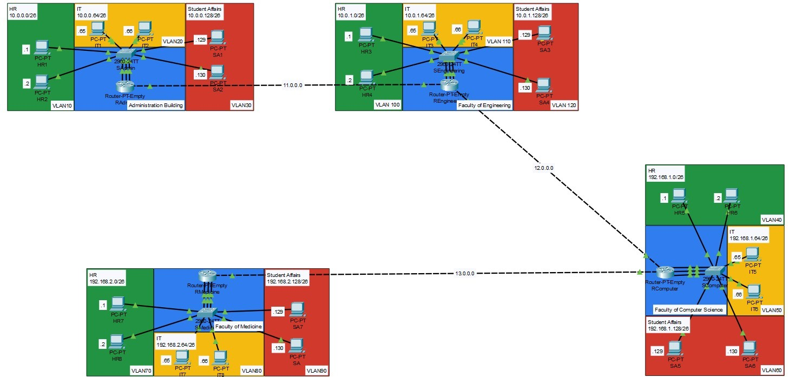
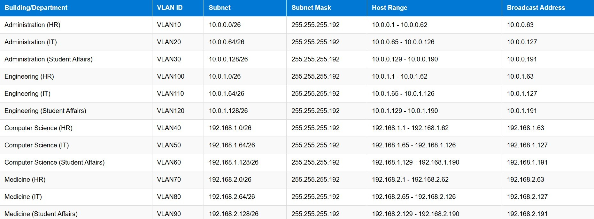
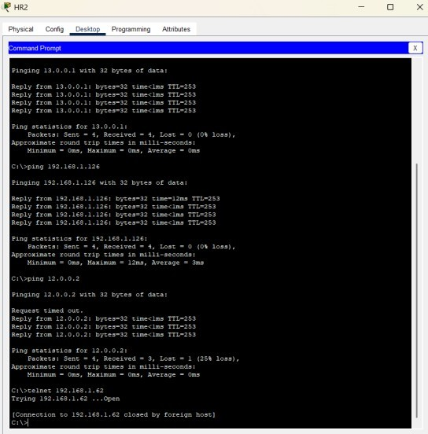

# شبكة جامعة حلوان الأهلية (Cisco Packet Tracer)

[English](README.md) | **العربية**

<div dir="rtl">

تصميم ومحاكاة شبكة لأربع مباني في جامعة حلوان الأهلية (HNU) باستخدام Cisco Packet Tracer. كل قسم له VLAN مستقل، وكل VLAN له شبكة فرعية /26، وكل مبنى له راوتر، والربط بين المباني بـ RIP، والإدارة عن بُعد بـ Telnet. المشروع لمادة COM204 (شبكات الحاسب)، العام الدراسي 2024/2025.

</div>



<div dir="rtl">

## نظرة سريعة

| البند | القيمة |
| --- | --- |
| المباني | الإدارة، الهندسة، الحاسبات والمعلومات (CSIT)، الطب |
| الأجهزة | 4 راوترات (Router-PT-Empty)، 4 سويتشات (2960-24TT)، 24 جهاز PC |
| الأقسام في كل مبنى | HR وIT وشؤون الطلاب (3 VLANs لكل مبنى، 12 إجمالاً) |
| حجم الشبكة الفرعية | /26 (255.255.255.192)، 62 جهاز قابل للاستخدام |
| الروابط بين المباني | 11.0.0.0 و12.0.0.0 و13.0.0.0 (نقطة لنقطة، /24) |
| التوجيه | RIP v2 |
| الإدارة عن بُعد | Telnet |
| الأداة | Cisco Packet Tracer |

## المخطط

الراوترات متوصلة على خط واحد:

</div>

```
Administration --11.0.0.0-- Engineering --12.0.0.0-- CSIT --13.0.0.0-- Medicine
```

<div dir="rtl">

كل مبنى فيه راوتر وسويتش. السويتش بيشيل الـ VLANs التلاتة للأقسام والراوتر هو الـ gateway ليهم. الألوان في الرسم: الأزرق للمبنى، الأخضر HR، الأصفر IT، الأحمر شؤون الطلاب.

## خطة العنونة

| المبنى | القسم | VLAN | الشبكة الفرعية | نطاق الأجهزة | Broadcast |
| --- | --- | --- | --- | --- | --- |
| الإدارة | HR | 10 | 10.0.0.0/26 | 10.0.0.1 - 10.0.0.62 | 10.0.0.63 |
| الإدارة | IT | 20 | 10.0.0.64/26 | 10.0.0.65 - 10.0.0.126 | 10.0.0.127 |
| الإدارة | شؤون الطلاب | 30 | 10.0.0.128/26 | 10.0.0.129 - 10.0.0.190 | 10.0.0.191 |
| الهندسة | HR | 100 | 10.0.1.0/26 | 10.0.1.1 - 10.0.1.62 | 10.0.1.63 |
| الهندسة | IT | 110 | 10.0.1.64/26 | 10.0.1.65 - 10.0.1.126 | 10.0.1.127 |
| الهندسة | شؤون الطلاب | 120 | 10.0.1.128/26 | 10.0.1.129 - 10.0.1.190 | 10.0.1.191 |
| CSIT | HR | 40 | 192.168.1.0/26 | 192.168.1.1 - 192.168.1.62 | 192.168.1.63 |
| CSIT | IT | 50 | 192.168.1.64/26 | 192.168.1.65 - 192.168.1.126 | 192.168.1.127 |
| CSIT | شؤون الطلاب | 60 | 192.168.1.128/26 | 192.168.1.129 - 192.168.1.190 | 192.168.1.191 |
| الطب | HR | 70 | 192.168.2.0/26 | 192.168.2.1 - 192.168.2.62 | 192.168.2.63 |
| الطب | IT | 80 | 192.168.2.64/26 | 192.168.2.65 - 192.168.2.126 | 192.168.2.127 |
| الطب | شؤون الطلاب | 90 | 192.168.2.128/26 | 192.168.2.129 - 192.168.2.190 | 192.168.2.191 |

</div>



<div dir="rtl">

الأرقام القصيرة في الرسم زي `.1` و`.2` و`.65` و`.66` و`.129` و`.130` هي الجزء الأخير من عنوان كل جهاز. مثلاً HR2 في الإدارة عنوانه `10.0.0.2`.

## مثال على إعداد الراوتر

مثال لراوتر CSIT بالقيم الموجودة في توثيق المشروع. غيّر اسم الجهاز وكلمات المرور بتاعتك.

</div>

```
enable
configure terminal
hostname HNU-CSIT

interface gigabitEthernet 0/0
 ip address 192.168.1.62 255.255.255.192
 no shutdown

interface gigabitEthernet 0/4
 ip address 12.0.0.2 255.255.255.0
 no shutdown

router rip
 version 2
 no auto-summary
 network 192.168.1.0
 network 12.0.0.0
 network 13.0.0.0
```

<div dir="rtl">

المثال ده إعادة صياغة للقيم الموثقة، مش تصدير من ملف Packet Tracer. راجع الإعداد الفعلي جوه ملف الـ `.pkt`.

## الاختبار

</div>



<div dir="rtl">

من الجهاز `HR2` (عنوانه 10.0.0.2 في الإدارة):

| الاختبار | النتيجة |
| --- | --- |
| `ping 13.0.0.1` | 4 من 4 ردود |
| `ping 192.168.1.126` (شبكة IT في CSIT) | 4 من 4 ردود |
| `ping 12.0.0.2` | 3 من 4 ردود (أول طلب انتهت مهلته، وده طبيعي أثناء ARP) |
| `telnet 192.168.1.62` | الاتصال فتح ثم الراوتر قفله |

الـ ping بيثبت إن الترافيك بيعدّي بين المباني. الـ Telnet بيوصل للراوتر لكن الجلسة بتتقفل علطول، فالصورة دي لا تثبت تسجيل الدخول عن بُعد بالكامل.

## محتويات الريبو

</div>

```
.
├── README.md                     README بالإنجليزي
├── README.ar.md                  README بالعربي
├── LICENSE
├── packet-tracer/
│   └── hnu-campus-network.pkt    ملف مشروع Packet Tracer
├── images/
│   ├── topology.jpg
│   ├── subnetting-plan.jpg
│   └── connectivity-test.jpg
└── docs/
    ├── network-documentation.md  توثيق المشروع (بالإنجليزي)
    └── course-brief.pdf          تكليف المشروع (COM204)
```

<div dir="rtl">

## التوثيق

شوف [docs/network-documentation.md](docs/network-documentation.md) للتصميم والمكونات ومثال الإعداد وملاحظات الاختبار (بالإنجليزي).

## طريقة فتح المشروع

1. نزّل Cisco Packet Tracer.
2. افتح الملف `packet-tracer/hnu-campus-network.pkt`.
3. افتح Command Prompt على أي PC وجرّب الاختبارات اللي فوق.

## الحدود والتحسينات الجاية

- كل الـ 12 شبكة فرعية بنفس الحجم (/26). ده تقسيم ثابت الطول وليس VLSM. لو كل شبكة اتحسبت على حجم قسمها وروابط الراوترات بقت /30 هنوفر عناوين.
- مستخدم أول 3 كتل /26 بس من نطاق كل مبنى، وكل VLAN فيه جهازين.
- Telnet بيبعت كلمات المرور نص عادي. في أي شبكة حقيقية استخدم SSH مع `enable secret` و`service password-encryption`.
- ضيف ACLs للتحكم في الترافيك بين الأقسام، وجرّب OSPF بديل لـ RIP.
- ضيف DHCP pools لكل VLAN (تكليف المادة بيطلب DHCP). التوثيق الموجود في الريبو مش بيوضحها.
- المخطط على خط واحد، فانقطاع رابط واحد بيقسم الكامبس. ring أو روابط احتياطية تحل ده.

## المؤلف

إبراهيم حمدي ([@Ibrahim-Al-Jid](https://github.com/Ibrahim-Al-Jid)).

## الترخيص

MIT. شوف ملف [LICENSE](LICENSE).

</div>
