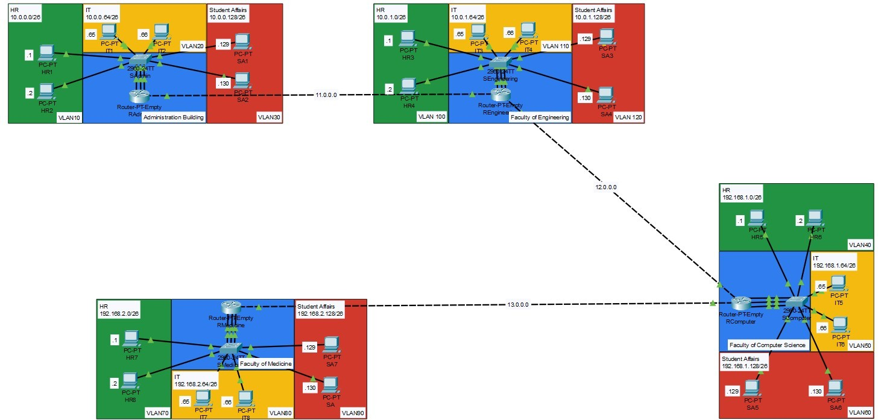
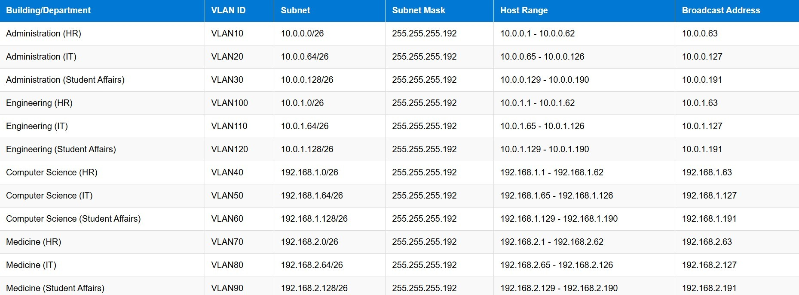
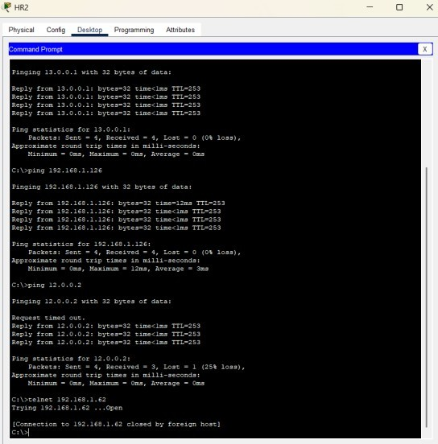

# HNU Campus Network (Cisco Packet Tracer)

**English** | [العربية](README.ar.md)

A campus network for four buildings of Helwan National University (HNU), designed and simulated in Cisco Packet Tracer. It uses one VLAN per department, a /26 subnet per VLAN, a router per building and RIP routing between buildings, with remote management over Telnet. Built for the COM204 Computer Networks course, academic year 2024/2025.



## At a glance

| Item | Value |
| --- | --- |
| Buildings | Administration, Engineering, Computer Science & IT (CSIT), Medicine |
| Devices | 4 routers (Router-PT-Empty), 4 switches (2960-24TT), 24 PCs |
| Departments per building | HR, IT, Student Affairs (3 VLANs per building, 12 in total) |
| Subnet size | /26 (255.255.255.192), 62 usable hosts each |
| Inter-building links | 11.0.0.0, 12.0.0.0, 13.0.0.0 (point-to-point, /24) |
| Routing | RIP v2 |
| Remote management | Telnet |
| Tool | Cisco Packet Tracer |

## Topology

The routers are connected in a line:

```
Administration --11.0.0.0-- Engineering --12.0.0.0-- CSIT --13.0.0.0-- Medicine
```

Each building has one router and one switch. The switch carries the three department VLANs and the router is the gateway for them. Colors in the diagram: blue is the building, green is HR, yellow is IT, red is Student Affairs.

## Addressing plan

| Building | Department | VLAN | Subnet | Host range | Broadcast |
| --- | --- | --- | --- | --- | --- |
| Administration | HR | 10 | 10.0.0.0/26 | 10.0.0.1 - 10.0.0.62 | 10.0.0.63 |
| Administration | IT | 20 | 10.0.0.64/26 | 10.0.0.65 - 10.0.0.126 | 10.0.0.127 |
| Administration | Student Affairs | 30 | 10.0.0.128/26 | 10.0.0.129 - 10.0.0.190 | 10.0.0.191 |
| Engineering | HR | 100 | 10.0.1.0/26 | 10.0.1.1 - 10.0.1.62 | 10.0.1.63 |
| Engineering | IT | 110 | 10.0.1.64/26 | 10.0.1.65 - 10.0.1.126 | 10.0.1.127 |
| Engineering | Student Affairs | 120 | 10.0.1.128/26 | 10.0.1.129 - 10.0.1.190 | 10.0.1.191 |
| CSIT | HR | 40 | 192.168.1.0/26 | 192.168.1.1 - 192.168.1.62 | 192.168.1.63 |
| CSIT | IT | 50 | 192.168.1.64/26 | 192.168.1.65 - 192.168.1.126 | 192.168.1.127 |
| CSIT | Student Affairs | 60 | 192.168.1.128/26 | 192.168.1.129 - 192.168.1.190 | 192.168.1.191 |
| Medicine | HR | 70 | 192.168.2.0/26 | 192.168.2.1 - 192.168.2.62 | 192.168.2.63 |
| Medicine | IT | 80 | 192.168.2.64/26 | 192.168.2.65 - 192.168.2.126 | 192.168.2.127 |
| Medicine | Student Affairs | 90 | 192.168.2.128/26 | 192.168.2.129 - 192.168.2.190 | 192.168.2.191 |



In the diagram, the short labels such as `.1`, `.2`, `.65`, `.66`, `.129`, `.130` are the host part of each PC address. For example HR2 in Administration is `10.0.0.2`.

## Sample router configuration

Example for the CSIT router, using the values from the project documentation. Replace the hostname and passwords with your own.

```
enable
configure terminal
hostname HNU-CSIT

interface gigabitEthernet 0/0
 ip address 192.168.1.62 255.255.255.192
 no shutdown

interface gigabitEthernet 0/4
 ip address 12.0.0.2 255.255.255.0
 no shutdown

router rip
 version 2
 no auto-summary
 network 192.168.1.0
 network 12.0.0.0
 network 13.0.0.0
```

This sample is a reconstruction of the documented values, not an export of the Packet Tracer file. Check the real configuration in the `.pkt` file.

## Testing



From PC `HR2` (10.0.0.2, Administration):

| Test | Result |
| --- | --- |
| `ping 13.0.0.1` | 4 of 4 replies |
| `ping 192.168.1.126` (CSIT IT subnet) | 4 of 4 replies |
| `ping 12.0.0.2` | 3 of 4 replies (first request timed out, normal while ARP resolves) |
| `telnet 192.168.1.62` | Connection opened, then closed by the remote host |

The pings show that traffic crosses buildings. The Telnet attempt reaches the router but the session ends right away, so remote login is not fully demonstrated by this screenshot.

## Repository contents

```
.
├── README.md                     English README
├── README.ar.md                  Arabic README
├── LICENSE
├── packet-tracer/
│   └── hnu-campus-network.pkt    Packet Tracer project file
├── images/
│   ├── topology.jpg
│   ├── subnetting-plan.jpg
│   └── connectivity-test.jpg
└── docs/
    ├── network-documentation.md  Step-by-step project documentation
    └── course-brief.pdf          Course project brief (COM204)
```

## Documentation

See [docs/network-documentation.md](docs/network-documentation.md) for the design, components, configuration example and test notes.

## How to open the project

1. Install Cisco Packet Tracer.
2. Open `packet-tracer/hnu-campus-network.pkt`.
3. Open the Command Prompt on any PC and run the tests above.

## Limits and next steps

- All 12 subnets are the same size (/26). That is fixed-length subnetting, not VLSM. Sizing each subnet to its department and using /30 links between routers would save addresses.
- Only the first three /26 blocks of each building range are used, and each VLAN has two PCs.
- Telnet sends passwords in clear text. Use SSH, `enable secret` and `service password-encryption` for any real network.
- Add access control lists to limit traffic between departments, and test OSPF as an alternative to RIP.
- Add DHCP pools per VLAN (the course brief asks for DHCP). The documentation in this repository does not show them.
- The topology is a line, so one failed link splits the campus. A ring or redundant links would remove that.

## Author

Ibrahim Hamdy ([@Ibrahim-Al-Jid](https://github.com/Ibrahim-Al-Jid)).

## License

MIT. See [LICENSE](LICENSE).
