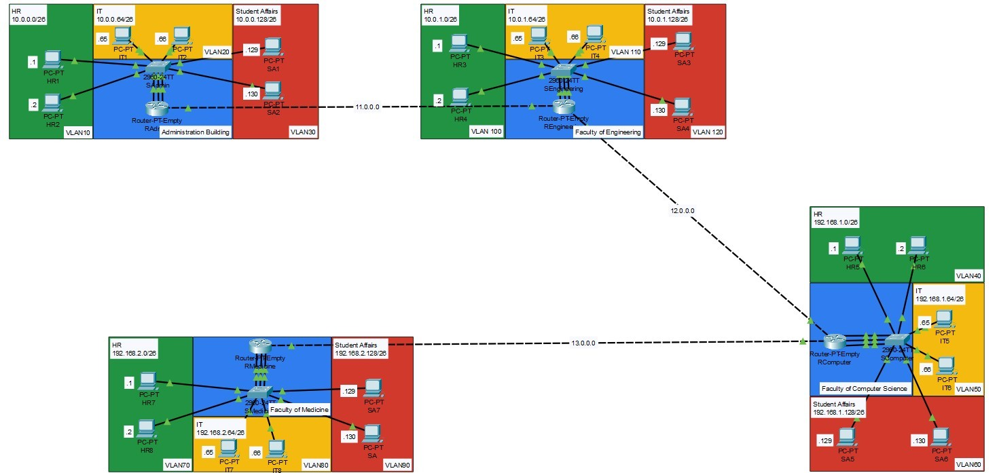
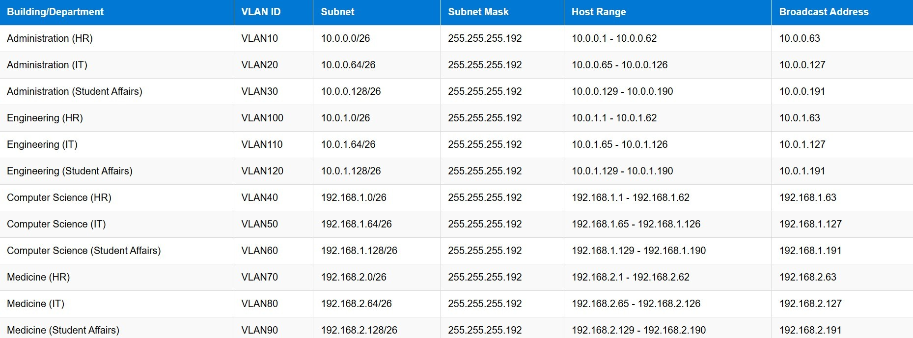
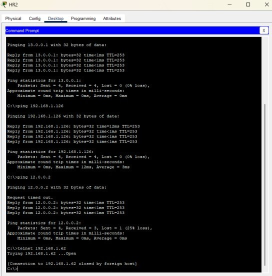

# Network Design Documentation

Project documentation for the HNU campus network (COM204 Computer Networks, 2024/2025). For a summary and the full addressing table, see the [README](../README.md).

## 1. Objective

Build a modern network for Helwan National University (HNU). This first phase connects four buildings only:

1. Administration Building
2. Faculty of Engineering
3. Faculty of Computer Science and Information Technology (CSIT)
4. Faculty of Medicine

The design uses VLANs for department separation, RIP for dynamic routing between buildings, and Telnet for remote management of the network devices.

## 2. Network design

The topology was built in Cisco Packet Tracer. The layout loosely follows the real arrangement of the university buildings.



### Components

| Component | Model | Count | Role |
| --- | --- | --- | --- |
| Router | Router-PT-Empty | 4 | One per building, gateway for the building VLANs and link to the next building |
| Switch | 2960-24TT | 4 | One per building, carries the department VLANs |
| End device | PC-PT | 24 | Two PCs per department (HR, IT, Student Affairs) in each building |

### Reading the diagram

- Blue: the building. Green: HR. Yellow: IT. Red: Student Affairs.
- Numbers next to a PC such as `.1`, `.2`, `.65`, `.66`, `.129`, `.130` are the host part of its IPv4 address. Example: HR2 in Administration has `10.0.0.2`.
- The routers are linked in a line through `11.0.0.0` (Administration to Engineering), `12.0.0.0` (Engineering to CSIT) and `13.0.0.0` (CSIT to Medicine).
- Each department has its own VLAN, shown next to the department in the diagram.

## 3. Subnetting plan

Each department VLAN uses one /26 subnet (mask `255.255.255.192`, 62 usable hosts). The table below is the original subnetting plan.



Columns: building and department, VLAN ID, subnet, mask, usable host range, broadcast address (the last address of the subnet, for example `10.0.0.63`).

The full 12-row table is in the [README](../README.md#addressing-plan).

## 4. Configuration

Example for the CSIT router, using the documented interface addresses. This is an illustration of the approach, not an export of the Packet Tracer file.

```
Router> enable
Router# configure terminal
Router(config)# hostname HNU-CSIT
Router(config)# enable secret <choose-a-password>

Router(config)# interface gigabitEthernet 0/0
Router(config-if)# ip address 192.168.1.62 255.255.255.192
Router(config-if)# no shutdown

Router(config)# interface gigabitEthernet 0/4
Router(config-if)# ip address 12.0.0.2 255.255.255.0
Router(config-if)# no shutdown

Router(config)# router rip
Router(config-router)# version 2
Router(config-router)# no auto-summary
Router(config-router)# network 192.168.1.0
Router(config-router)# network 12.0.0.0
Router(config-router)# network 13.0.0.0
```

Use your own strong password. Do not reuse a lab password on a real device.

## 5. Testing



Commands run from `HR2` (10.0.0.2, Administration):

| Command | Result |
| --- | --- |
| `ping 13.0.0.1` | 4 of 4 replies |
| `ping 192.168.1.126` | 4 of 4 replies |
| `ping 12.0.0.2` | 3 of 4 replies (the first request timed out while ARP resolved) |
| `telnet 192.168.1.62` | Connection opened, then closed by the remote host |

Traffic crosses buildings. The Telnet test reaches the router but the session closes immediately, so the screenshot does not show a completed remote login.

## 6. Challenges and solutions

| Challenge | Solution |
| --- | --- |
| Misconfigured VLANs broke communication | Double-check VLAN IDs and port assignments |
| Routing misconfiguration left buildings unreachable | Test and validate the routing protocol (RIP here, OSPF as an option) |
| IP conflicts during manual addressing | Use DHCP where possible |

## 7. Conclusion

The design connects the four main buildings of Helwan National University with VLAN segmentation and /26 subnets, and the pings show inter-building connectivity. It can be extended with more faculties and services. The next steps (SSH instead of Telnet, access control lists, DHCP pools, redundant links) are listed in the [README](../README.md#limits-and-next-steps).
